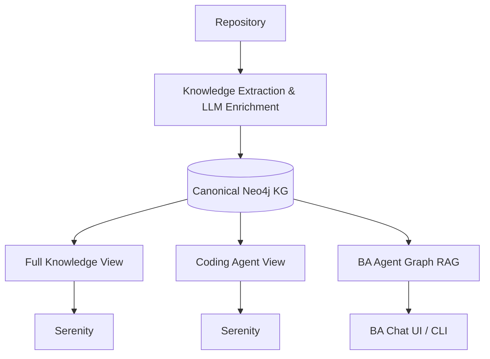
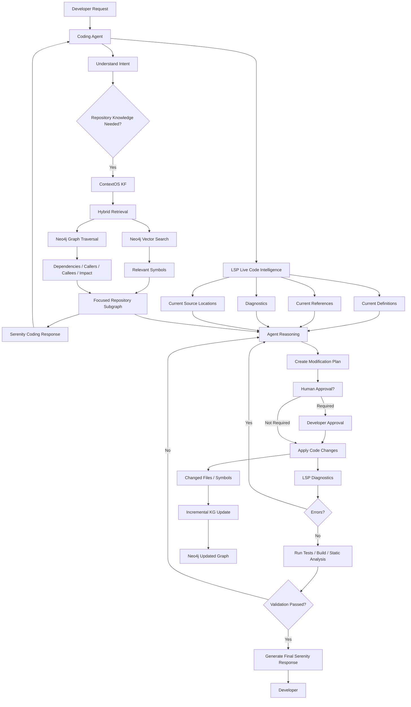

# Code Knowledge Extraction

Extract knowledge from a source-code repository and return it in a Serenity response. The extracted knowledge is intended for downstream consumers; ContextOS Knowledge Fabric (KF) modules own its storage and retrieval.

## Input

- A code repository to analyze.

The extractor reads the repository and derives knowledge from its source, such as symbols, relationships, dependencies, architecture, and behavior. Results should be grounded in repository evidence so consumers can trace conclusions back to the code.

## Response modes

Both modes use Serenity as the response format. They differ in scope and intended consumer:

1. **Full knowledge (batch):** Return the comprehensive knowledge extracted from the repository for batch processing and downstream ingestion.
2. **Coding agent interface:** Return the relevant, focused knowledge for a coding agent working with the repository, shaped for agent consumption rather than as a full-repository dump.

## Responsibility boundary

This component is responsible for analyzing the input repository and producing the selected Serenity response. It does not define or implement how extracted knowledge is stored, indexed, or retrieved; those responsibilities belong to the ContextOS Knowledge Fabric modules.

## Project layout

```text
src/conseek_knowledge_fabric/
    app/
        main.py              FastAPI routes and server entry point
        schemas.py           Request and response validation
    utils/
        graph_pipeline.py    Repository-to-Neo4j ingestion workflow
        browser_views.py     Neo4j Browser view links
        logging.py           Structured thread-aware logging
        redis.py             Redis conversation memory, embedding, and QA cache
    static/
        index.html           Local graph-builder web interface
        ba_chat.html         Business Analyst (BA) Agent chat interface
    views/
        full.py              Full-knowledge projection
        coding_agent.py      Coding-agent projection
    graphify_analysis.py     Graphify AST extraction, LLM summaries, and embeddings
    ba_agent.py              Neo4j Graph RAG Business Analyst chatbot and CLI
    react_agent.py           ReAct tool-calling Business Analyst agent
    clone.py                 Git access check, branch switch, and shallow clone
    models.py                Canonical graph, summaries, embeddings, and evidence
    neo4j_store.py           Idempotent Neo4j graph persistence
    scip.py                  Optional SCIP index enrichment
    security.py              Dependency, source, malware, and build checks
    security_rules.yml       Semgrep and heuristic security audit rules
    serenity.py              Serenity response envelope
    cli.py                   Command-line extraction interface
main.py                      Root launcher (python main.py)
tests/
```

## Setup and tests

Install the package in editable mode and run the test suite:

```sh
python -m pip install -e .
python -m unittest discover -s tests
```

## Web UI (Graph Builder & BA Agent Chat)

Run the local FastAPI server with:

```sh
codefabric-web
```

The root launcher works too: `python main.py` (supports `CODEFABRIC_HOST` and `CODEFABRIC_PORT`, defaulting to `127.0.0.1:8000`).

Application logs use `DATETIME:THREAD_NO:LEVEL:FUNC:MESSAGE` and cover API calls, branch validation, remote access, clone/switch, repository audits, Graphify extraction, LLM summarization/embedding, Neo4j writes, BA chat retrieval, and Browser URL construction. Set `CODEFABRIC_LOG_LEVEL` to `DEBUG`, `INFO`, `WARNING`, or `ERROR` (default `INFO`). Call arguments and return values are not logged, so credentials and repository contents are not included.

- **Graph Builder (`http://127.0.0.1:8000/`):** Enter a local path or Git URL, an optional branch, and Neo4j credentials, build the graph, then select a projection to open its repository-scoped query in Neo4j Browser. For remote URLs, the selected branch is verified with `git ls-remote` and shallow-cloned. For local paths, it runs `git switch`; Git will refuse if local changes conflict, and the app never forces or discards them. Leave the branch blank to use the default branch/current checkout. Set the Browser HTTP URL separately from the Bolt URI for custom ports or remote instances. The UI binds to localhost and does not save or return the password; `.env` can also provide Git clone credentials.
- **BA Agent Chat (`http://127.0.0.1:8000/ba-chat`):** Ask questions about the ingested repository in plain, business-friendly language (e.g., entry points, project scope, architecture, and workflows). Supports multi-session chat management, inspectable Neo4j source evidence, and optional per-request Neo4j connection overrides.
- **API Docs (`http://127.0.0.1:8000/api/docs`):** Interactive OpenAPI documentation for `POST /api/build`, `POST /api/ba-chat`, `GET /api/ba-chat/sessions/{session_id}`, and `DELETE /api/ba-chat/sessions/{session_id}`.

## Command-line extraction

Extract a repository and write a full Serenity response to stdout:

```sh
codefabric-extract ./path/to/repository
```

Generate a focused coding-agent view or write output to a file:

```sh
codefabric-extract ./path/to/repository --mode coding-agent --focus my_symbol --output response.json
```

During extraction, `graphify_analysis.py` detects and parses source files (up to 1 MB per file) using Graphify, generates evidence-grounded behavioral summaries (`symbol_summary` and `relationship_summary`) and vector embeddings (`symbol_summary_embedding` and `relationship_summary_embedding`) via LiteLLM (using Gemini as primary and Ollama as fallback), and writes an enriched snapshot to `graphify-out/ast_graph_summarized.json`.

To persist extracted files, symbols, summaries, embeddings, and relationships to Neo4j, set the connection values in the environment or `.env` and opt in with `--neo4j`:

```sh
export NEO4J_URI=bolt://localhost:7687
export NEO4J_USERNAME=neo4j
export NEO4J_PASSWORD=your-local-password
codefabric-extract ./path/to/repository --neo4j
```

The loader creates `Repository`, `File`, and `Symbol` nodes, plus `Import` targets and `ExternalSymbol` nodes only for unresolved targets. `DEFINES` and typed `CODE_RELATION` edges preserve file and source relationships along with generated summaries and embedding vectors. Stable repository-scoped IDs and `MERGE` make repeated imports idempotent. Use `--neo4j-database` or `NEO4J_DATABASE` to select a database. The account needs permission to create constraints and write nodes/relationships.

## Business Analyst (BA) Chatbot CLI

Query the Neo4j knowledge graph from the terminal in single-question or interactive mode:

```sh
# Interactive chat session
codefabric-ba

# Single question with custom session ID
codefabric-ba "What are the main entry points and workflows?" --session-id my-session
```

The BA Agent (`RepoBAChatbot` in `ba_agent.py`, plus the ReAct tool-calling variant in `react_agent.py`) combines:

- **Neo4j Hybrid Graph RAG:** Queries the `symbol_embeddings` vector index (with Cypher cosine-similarity fallback), traverses `CODE_RELATION` edges for callers/callees/dependencies, and merges keyword/intent matches for repository scope and entry points.
- **LiteLLM / Gemini & Ollama Fallback:** Resolves conversational follow-ups and translates technical graph evidence into clear explanations for non-technical stakeholders.
- **Redis Memory (`utils/redis.py`):** Stores session conversation history, caches query embeddings, and caches QA responses via `REDIS_URL` (default `redis://localhost:6379/0`), automatically falling back to in-memory storage when Redis is unavailable.

### LLM, Embedding, and Cache Environment Variables

| Variable | Purpose | Default |
| :--- | :--- | :--- |
| `GEMINI_API_KEY` / `GOOGLE_API_KEY` | API key for Gemini LLM and embedding calls | — |
| `PRIMARY_LLM_MODEL` / `GEMINI_MODEL` | Primary LLM for summaries (`graphify_analysis.py`) and BA chat (`ba_agent.py`) | `gemini/gemini-3.5-flash` |
| `FALLBACK_LLM_MODEL` / `OLLAMA_MODEL` | Fallback local Ollama LLM when primary fails | `ollama/gemma3:1b` (extraction) / `ollama/gemma3:4b` (BA chat) |
| `PRIMARY_EMBEDDING_MODEL` | Embedding model for symbol/relationship vectors and RAG queries | `gemini/text-embedding-004` (extraction) / `nomic-embed-text:latest` (BA chat) |
| `FALLBACK_EMBEDDING_MODEL` / `OLLAMA_EMBED_MODEL` | Fallback Ollama embedding model | `ollama/nomic-embed-text:latest` |
| `OLLAMA_URL` | Base URL for local Ollama server | `http://localhost:11434` |
| `REDIS_URL` | Redis connection URL for conversation history, embedding, and QA cache | `redis://localhost:6379/0` |

## Remote repositories and security auditing

Pass a remote Git URL to shallow-clone it first. Clones go under `.codefabric/repos/<repository-name>` by default; use `--clone-root` to change that directory:

```sh
codefabric-extract https://github.com/owner/repository.git --clone-root ./repos
```

Before cloning, the CLI runs `git ls-remote` to verify access. For private GitHub/GitLab HTTPS repositories, put `GITHUB_TOKEN`/`GH_TOKEN` or `GITLAB_TOKEN` in the process environment or project-root `.env`. Azure DevOps accepts `AZURE_DEVOPS_EXT_PAT` or `AZURE_DEVOPS_TOKEN`; use `--env-file` to select another file. For other HTTPS Git servers, set `GIT_USERNAME` and `GIT_TOKEN`. Relative `.env` paths are resolved from the project root if the process working directory differs. Credentials are passed through host-scoped temporary Git configuration, never embedded in the URL or command arguments. Git askpass prompts are disabled for clone subprocesses. `.env` and `.codefabric/` are ignored by Git.

After resolving the repository, the CLI automatically validates common JSON, TOML, XML, YAML, and Docker build manifests without running build scripts. It also runs OSV Scanner for dependency advisories, Semgrep's `p/security-audit` rules plus local constant-loop review rules (`security_rules.yml`), and ClamAV when those tools are installed. Missing scanners are reported as `SKIPPED`, not as clean results. OSV detects known vulnerable dependencies; ClamAV performs signature-based malware scanning. Constant-true-loop matches are heuristics and may include intentional loops.

## SCIP semantic enrichment

To include semantic references, generate `index.scip` with a language-specific SCIP indexer and install the SCIP CLI, then pass the index:

```sh
codefabric-extract ./path/to/repository --scip-index ./path/to/repository/index.scip
```

The Tree-sitter grammars currently included are Python, JavaScript, TypeScript, Java, Go, and Rust. SCIP enrichment consumes an existing index via `scip print --json`; it does not run an indexer or launch an LSP server. The response envelope is intentionally local to this project until a formal Serenity schema is supplied.


## Overall Flow




## End to End Code Flow

